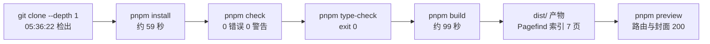

## 背景：想验证的是「手机上能不能把仓库跑到 dist」

我想验证的问题只有一句话：不打开电脑，只靠一台 Android 手机，能不能把这个博客仓库从零克隆下来，并跑完安装、静态检查、类型检查和生产构建。

这个站是 Astro 7 + Firefly 主题，仓库在 `master` 分支、只有 1 个提交、单一远程 `origin`、3 篇文章目录，同时放着 `wrangler.jsonc` 和 `vercel.json` 两套部署配置（后者的 `buildCommand` 就是 `pnpm build`）。也就是说手机端能负责的只是「把 `dist` 产出」，上线仍然交给外部平台——这也决定了本文的范围止于「跑出 `dist` 并在本地预览」，不含部署。

手机是 Android 13，上面套了一层 PRoot 式的 Ubuntu 24.04.3 LTS 用户态。下面三条输出足以判断这不是虚拟机，而是挂在 Android 应用数据目录里的 PRoot 用户态：

```bash
$ uname -a
Linux localhost 5.15.123-android13-8-00008-g3ca6a2912c7e-ab11087001 #1 SMP PREEMPT ... aarch64 GNU/Linux
$ grep PRETTY_NAME /etc/os-release
PRETTY_NAME="Ubuntu 24.04.3 LTS"
$ env | grep -i proot
PROOT_TMP_DIR=/data/user/0/dsh.android.client/files/linux/tmp
PROOT_LOADER=/data/app/~~.../lib/arm64/libprootloader.so
PROOT_L2S_DIR=/data/user/0/dsh.android.client/files/linux/ubuntu/.l2s
```

内核和用户态不同源（Android 内核 + Ubuntu 用户态），路径又都落在 `/data/user/0/...` 下，所以本文的判断标准是「能不能跑通」；耗时数据是后面用文件与日志时间戳反推的，不是秒表读数。

| 项目 | 值 |
| --- | --- |
| Android 内核 | `5.15.123-android13`（完整串见上面的 `uname -a`） |
| Ubuntu 用户态 | 24.04.3 LTS（noble） |
| Node.js | v24.19.0 |
| pnpm | 11.22.0（`package.json` 的 `packageManager` 同为 `pnpm@11.22.0`） |
| git | 2.43.0 |
| Astro / Svelte | 7.3.2 / `^5.57.0`（均为 `package.json` 声明） |
| Pagefind | `^1.5.2`（`package.json` 声明；构建产物里的运行版本是 1.5.2） |
| wrangler | 4.147.0 |
| CPU / 内存 | 8 核 / 约 10.9 GiB |

除标注 `package.json` 的三行外，上表都是当场用命令读出来的。

## 方案：五步，从克隆到预览

这条链路是五条命令，全部在本轮实际执行过。前四步负责产出，最后一步 `pnpm preview` 起本地静态服务，用来确认产物和路由真的能访问。

```bash
# 1. 克隆：浅克隆，只取 master 最新一次提交
cd ~ && git clone --depth 1 https://github.com/WirepullerDX/blog.git Blog && cd Blog

# 2. 安装依赖：用 --frozen-lockfile，保证不改 lockfile
pnpm install --frozen-lockfile

# 3. 静态检查与类型检查
pnpm check
pnpm type-check

# 4. 生产构建
pnpm build

# 5. 预览产物：另起一个进程，默认监听 localhost:4321
pnpm preview
```

本轮实际目录就是 `/root/Blog`（root 用户的 `~` 即 `/root`）；如果你不是 root，把 `~/Blog` 换成自己的路径即可。

### 1. 克隆：浅克隆，只取最新一次提交

`--depth 1` 省掉了历史对象，也解释了为什么后面 `git rev-list --count HEAD` 只有 1。这两点可以直接验证：

```bash
$ ls .git/shallow
94bc8eb4f1a49c08297e4d6c834749066e0f38b2
$ git rev-list --count HEAD
1
```

`.git/shallow` 存在即说明是浅克隆；如果先 `cd` 进一个已存在且非空的目录再 `clone .`，git 会直接报「destination path already exists and is not an empty directory」，所以这里把目标目录交给 `clone` 自己创建。

### 2. 安装依赖：`--frozen-lockfile` 让工作区保持干净

仓库的 `package.json` 里有 `"preinstall": "npx only-allow pnpm"`，用 npm 或 yarn 装依赖会在第一步被拦住。本轮全程 pnpm，没有触发它。

`--frozen-lockfile` 的作用是不改写 `pnpm-lock.yaml`：装完之后 `git status --short` 依然是空的（`dist/` 在 `.gitignore` 第 2 行，本来就不计入）。安装结果 `node_modules` 占 1.1 GB，后续检查和构建都直接复用。

耗时可以用 pnpm 自己的落盘痕迹界定：store 目录在 `05:36:57` 建好，`store/v11/index.db` 在 `05:37:56` 写入，安装约 59 秒。另有一个容易读错的跨度：`package.json` 的 `05:36:22`（克隆检出）到 `node_modules/.modules.yaml` 的 `05:37:55` 是 93 秒，但这段包含克隆检出与 pnpm 启动，不等于安装耗时。

### 3. 检查与类型检查

`pnpm check` 是 Astro 的内容与组件诊断，`pnpm type-check` 是 `tsc --noEmit --isolatedDeclarations`。两者都不产出文件，结果见下一节。

### 4. 生产构建：内部是 8 段串行

`pnpm build` 不是一次 `astro build`，而是 `package.json` 里 8 段命令串起来：卡片数据 → LQIP → VNDB 封面 → Astro 构建 → 清理 pio 资源 → 字体子集化 → 内联脚本压缩 → Pagefind 索引。



这张图只画了本轮实测的五个环节。图本身是本仓库的运行时渲染（浏览器里执行 mermaid.js），`pnpm check` 不会校验它的语法，详见文末。

## 问题：几个需要提前知道的前提

### 构建脚本里是 `npx`，不是 `npm install`

`package.json` 的 `build` 全部由 `npx tsx scripts/xxx.ts` 串起来，`~/.npm/_logs/` 下的 7 个 debug 日志记的正是 `npm exec -- tsx scripts/xxx.ts`。需要区分两件事：本文没有用 `npm install` 或 `yarn` 装依赖，`preinstall` 的 `only-allow pnpm` 没有被触发；而构建子步骤由 `npx` 执行，是仓库既有写法，我没有改。这些日志的价值在于核对子进程数量与顺序，而不是发现 `npx` 本身——它明写在 `package.json` 里。

### 只看 `astro build` 成功不够

搜索索引是最后一步 `run-pagefind` 单独生成的，所以验收要盯 `dist/pagefind/pagefind-entry.json` 是否存在、里面页数是多少，而不是「Astro 没报错」。

### 内存余量比「10.9 GiB」看起来小

`MemTotal` 是 11465860 kB（约 10.9 GiB），但本轮记录的一次 `MemAvailable` 采样只有 2961504 kB（约 2.8 GiB）；我在安装与构建都结束、没有重任务运行时复测（05:54）是 2305696 kB（约 2.2 GiB）。同一台机器不同时刻差异明显，所以「10.9 GiB」只是总量，不代表构建期有这么多余量。这也是我全程串行执行、不并发跑别的重任务的原因。

> [!NOTE]
> 下面三条不影响本次任务，只作顺带记录：
>
> - 磁盘：`df -h` 显示 463 GB 总量、已用 356 GB、可用 107 GB（已用约 78%）；`node_modules` 1.1 GB、`dist` 16 MB。以这个任务的量级看，107 GB 可用是够的。
> - git 身份：`git config --get user.name` 与 `--get user.email` 都返回退出码 1。本轮不做任何提交，因此不影响构建。
> - 产物不进 git：`dist/` 在 `.gitignore` 里，构建完 `git status --short` 仍是 0 行，这属预期行为。

## 解决：用时间戳反推耗时，标出没验证的部分

耗时不用秒表，而是读文件和日志的时间戳：`npm` 日志的文件名是子进程启动时刻，日志文件的 mtime 是它退出时刻，`dist/` 的 mtime 是 Pagefind 收尾时刻。误差在秒级，但每一条都能复现：

```bash
$ stat -c '%y %n' package.json node_modules/.modules.yaml \
    ~/.local/share/pnpm/store/v11/projects \
    ~/.local/share/pnpm/store/v11/index.db dist
2026-10-30 05:36:22.072541108 +0000 package.json
2026-10-30 05:37:55.232541073 +0000 node_modules/.modules.yaml
2026-10-30 05:36:57.784541095 +0000 /root/.local/share/pnpm/store/v11/projects
2026-10-30 05:37:56.116541072 +0000 /root/.local/share/pnpm/store/v11/index.db
2026-10-30 05:41:22.200540994 +0000 dist
$ ls -1 --time-style=full-iso -l ~/.npm/_logs/
-rw-------. 1 root root 1643 2026-10-30 05:39:50.920541029 +0000 2026-10-30T05_39_43_838Z-debug-0.log
-rw-------. 1 root root 1307 2026-10-30 05:41:22.324540994 +0000 2026-10-30T05_41_17_780Z-debug-0.log
...（共 7 个日志，此处只留首尾两条）
```

每个日志文件里的 `argv` 能读到对应脚本（例如 `"exec" "--" "tsx" "scripts/generate-lqips.ts"`），文件名的时间是启动时刻，`ls` 那一列 mtime 是退出时刻。

`astro build` 没有自己的 npm 日志（它是项目依赖里的可执行文件），它夹在 `generate-vndb-covers` 退出（`05:39:58`）和 `prune-pio-assets` 启动（`05:41:02`）之间。把它和其他环节拼起来，`pnpm build` 的 99 秒可以拆成下表：

| 环节 | 起止（UTC） | 耗时 |
| --- | --- | --- |
| generate-github-card-data | 05:39:43.8 → 05:39:50.9 | 约 7.1 秒 |
| generate-lqips | 05:39:51.5 → 05:39:54.6 | 约 3.1 秒 |
| generate-vndb-covers（空跑） | 05:39:54.9 → 05:39:58.4 | 约 3.5 秒 |
| astro build | 05:39:58.4 → 05:41:02.2 | 约 63.8 秒 |
| prune-pio-assets | 05:41:02.2 → 05:41:06.8 | 约 4.5 秒 |
| subset-fonts | 05:41:06.8 → 05:41:10.8 | 约 4.0 秒 |
| minify-inline-scripts | 05:41:10.8 → 05:41:17.4 | 约 6.6 秒 |
| run-pagefind | 05:41:17.8 → 05:41:22.2 | 约 4.4 秒 |

八段相加约 97 秒，加上环节之间启动 `npx` 的零碎间隙，`05:39:43.8 → 05:41:22.2` 合计 98.4 秒，与 mermaid 里的「约 99 秒」对得上。

两个容易写错的地方值得单独说明：

- `generate-vndb-covers` 是空跑。`src/config/siteConfig.ts` 里 `vndb` 的 `mode` 是 `static`、`userId` 是 `u358128`，但 `downloadCovers` 为 `false`；`public/vndb-covers` 目录也不存在。所以 `05:39:54` 只是这个子进程的启动时刻，之后没有任何封面被下载，那 3.5 秒是 `tsx` 启动与判空后退出的开销。
- `astro build` 的 63.8 秒可以近似看作纯编译时间：因为上游 VNDB 步骤空跑、这一段没有任何网络下载。

## 结果：检查与产物的实测输出

`pnpm check`：

```bash
$ pnpm check
Result (259 files):
- 0 errors
- 0 warnings
- 0 hints
```

这里的 `259 files` 是诊断覆盖的文件规模，跟文章数无关（`dist/posts` 下只有 3 个目录）。我在加入这篇文章前后各跑一次，两次输出完全一致，耗时分别是 79.9 秒和 81.7 秒——运行时刻与机器负载不同就会有差异，所以这两个数字只作量级参考，不当作基线。

`pnpm type-check`（`tsc --noEmit --isolatedDeclarations`）退出码 0，耗时 9.3 秒。

在时间线上，检查与类型检查只能发生在这段空档里：`05:37:56`（安装落盘）到 `05:39:43`（构建第一个子进程启动）共 107 秒；按本轮实测（`check` 79.9 秒 + `type-check` 9.3 秒）合计 89.2 秒，余下约 18 秒是 `pnpm`/`astro` 的启动开销。

构建产物这边，把本文加入之前的那次构建里，`dist` 共 16 MB：`dist/index.html` 309549 字节、`dist/rss.xml` 1875 字节、`dist/sitemap-index.xml` 192 字节、`dist/posts` 1.2 MB、`dist/pagefind` 626 KB；加入本文重建后 `dist` 变成 17 MB、`dist/posts` 1.7 MB。搜索索引的页数可以直接从入口文件读出来：

```bash
$ node -e "const d=require('./dist/pagefind/pagefind-entry.json');
  console.log(d.version, d.languages['zh-cn'].page_count)"
1.5.2 8
```

也就是说：从 `05:36:22` 检出到 `05:41:22` Pagefind 收尾，共 300 秒（约 5 分钟），其中安装 59 秒、构建 99 秒，检查与类型检查全绿。那次构建索引出 7 页（当时站里 3 篇文章），加入本文后重建，索引页数变成 8。

预览用的是 `pnpm preview`，默认监听 `localhost:4321`。注意它只绑 IPv6 回环，用 `127.0.0.1` 连会直接连接失败，得写 `localhost`：

```bash
$ for u in /posts/astro-build-on-android-proot/ /og/astro-build-on-android-proot.png /rss.xml; do
    printf "%-42s " "$u"
    curl -s -o /dev/null -w "%{http_code}\n" "http://localhost:4321$u"
  done
/posts/astro-build-on-android-proot/       200
/og/astro-build-on-android-proot.png       200
/rss.xml                                   200
```

自己生成的 1600×900 封面 `cover.webp` 是 48102 字节，构建后由 Astro 输出成 `_astro/cover.*.webp`，预览里取回来同样是 48102 字节、HTTP 200，说明封面确实被当作图片资源处理了，不是被跳过的静态文件引用。`/og/astro-build-on-android-proot.png` 返回 200 则说明 `siteConfig.post.generateOgImages` 为 `true` 时构建会真的产出分享图。反过来，`/posts/astro-build-on-android-proot`（不带结尾斜杠）在这个静态预览里是 404，别把这个 404 当成文章没生成。

> [!WARNING]
> 下面这些在这个环境里没有凭据或没有执行，所以本文不声称它们通过：
>
> - 浏览器里的实际观感：没有可用的浏览器自动化，375px 溢出、深色模式、控制台报错都没法在本环境里自动确认，只验证了 HTTP 状态码和 HTML 结构
> - 向 `origin` 推送、开 PR（既无 git 身份也无凭据）
> - Cloudflare Workers 部署（环境里没有 `CLOUDFLARE_API_TOKEN`、`CF_WORKERS` 等变量，`wrangler` 可执行但未登录）
> - R2 / 对象存储上传（仓库配置里没有 R2 绑定，环境里也没有 `R2_*` 变量）
> - 构建期间的真实峰值内存（只做了构建前后的采样）
> - Mermaid 图的实际渲染效果：本仓库的 mermaid 是运行时渲染，`pnpm check` 不会校验它的语法，只能人工检查节点 id 与引号闭合；构建出的页面里 mermaid 只在浏览器里执行，所以这一项同样需要人眼确认

## 总结

五步都跑通了：安装、`pnpm check`、`pnpm type-check`、`pnpm build`、`pnpm preview` 在一台 Android 手机的 PRoot Ubuntu 用户态里全部完成，`dist` 产物齐全，文章路由和封面在本地预览里都是 200。

真正的限制不在「能不能跑」，而在两件事：一是内存余量有限，得把节奏放慢、避免并发；二是提交、推送、部署、对象存储上传这些环节在这个环境里没有凭据，只能留到有授权的环境再做，不能凭一次成功构建就宣布上线。

下一步只剩真实部署这一环：推送、PR、Cloudflare Pages 预览。这个站最初从 Firefly 模板搭起来的过程，写在[把博客搭到 Cloudflare：从 Firefly 模板到 R2、Twikoo 和自动部署](/posts/site-build-log-2026/)里。
