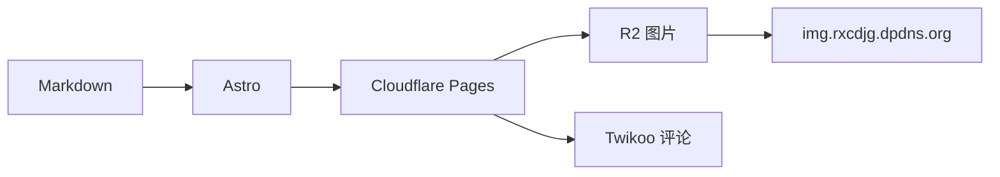

## 这篇文章测试什么

这是一篇用于验收博客渲染和部署链路的测试文章。它会把常见的内容类型尽量放在同一页里，方便一次性检查样式、脚本和远程资源。

> [!NOTE]
> 文章封面来自本地 `src` 目录，交给 Astro 优化；正文图片来自 Cloudflare R2 自定义域名。两者走的是完全不同的图片路径。

## R2 远程图片

下面是一张直接引用 R2 的单图，点击后应能打开灯箱：


## 图片网格

下面四张图来自同一个 R2 相册，用来测试 `[grid]` 语法和不同宽高比的排版：

[grid]


[/grid]

## 文本与列表

这段包含 **粗体**、*斜体*、~~删除线~~、`行内代码` 和一个[外部链接](https://developers.cloudflare.com/r2/)。

- 无序列表第一项
- 无序列表第二项
  - 嵌套列表项
  - 另一个嵌套列表项

1. 有序列表第一项
2. 有序列表第二项
3. 有序列表第三项

- [x] 已验证 R2 自定义域名
- [x] 已验证相册远程图片
- [ ] 待验证线上缓存规则
- [ ] 待验证移动端灯箱手势

## 引用与表格

> 把服务跑在自己手里，把内容留在自己的域名下。
>
> —— 阿杰

| 测试项 | 当前状态 | 备注 |
| --- | --- | --- |
| R2 图片 | 通过 | `img.rxcdjg.dpdns.org` 返回 200 |
| 相册 | 通过 | 使用 `urls.txt` 读取远程图片 |
| 项目页 | 待验证 | 封面为本地 WebP |
| 评论 | 待验证 | 需要 Twikoo 在线环境 |

## 数学公式

行内公式：$E = mc^2$。

块级公式：

$$
\int_{0}^{1} x^2 \, dx = \frac{1}{3}
$$

再来一个矩阵：

$$
\begin{bmatrix}
1 & 2 \\
3 & 4
\end{bmatrix}
\begin{bmatrix}
a \\
b
\end{bmatrix}
=
\begin{bmatrix}
a + 2b \\
3a + 4b
\end{bmatrix}
$$

## Mermaid 图表



## 代码与代码组

普通 TypeScript 代码块：

```ts
type TestResult = "pass" | "fail";

function checkImage(status: number): TestResult {
  return status === 200 ? "pass" : "fail";
}

console.log(checkImage(200));
```

带标签页的代码组：

::: code-group labels=[npm, pnpm]

```bash
npm install
```

```bash
pnpm install
```

:::

## 提醒框

> [!TIP]
> 提示框用于补充说明，不打断正文阅读。

> [!WARNING]
> 生产环境请关闭 R2 的 `r2.dev` 公共开发地址，使用自定义域名。

## GitHub 卡片

::github{repo="WirepullerDX/ayaka-meme-pack"}

## 验收清单

- [ ] 页面无控制台报错
- [ ] R2 图片能加载并打开灯箱
- [ ] 图片网格在手机端不溢出
- [ ] 数学公式、Mermaid 和代码组正常渲染
- [ ] GitHub 卡片能显示仓库信息
- [ ] 评论区和访问量统计正常

## 小结

如果这些内容都能正常显示，说明首页、文章页、R2 图片、相册、项目、Markdown 扩展和代码高亮的主链路基本跑通了。
