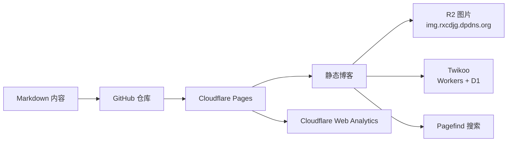

这篇文章不是“复制几条命令就完事”的快速部署教程，而是一份从模板站到真正可用的个人博客的搭建记录。

目标很明确：

- 内容掌握在自己手里
- 图片不把 Git 仓库撑爆
- 评论不依赖第三方 SaaS
- 构建和部署全部自动化
- 以后手机、电脑和 AI Agent 都能参与写作

## 最终架构



这套架构的核心是：**GitHub 负责源文件，Cloudflare Pages 负责构建和托管，R2 负责大图片，Twikoo 只负责评论。**

| 部件 | 实际使用 | 位置 |
|---|---|---|
| 博客框架 | Firefly 6.16.8 / Astro 7 | GitHub + Pages |
| 站点托管 | Cloudflare Pages | 全球边缘节点 |
| 图片 | Cloudflare R2 | `img.rxcdjg.dpdns.org` |
| 评论 | Twikoo 2.0.17 | Workers + D1 |
| 搜索 | Pagefind | 构建时生成 |
| 统计分析 | Cloudflare Web Analytics | 手动 JS 安装 |
| 自动部署 | Cloudflare Pages Git 集成 | push `master` 触发 |

## 从模板跑起来

最开始用的是 Firefly 模板。它不是单纯的 Astro 空项目，而是一套已经包含侧边栏、标签、归档、相册、友链、动态、音乐播放器和各种 Markdown 插件的完整主题。

本地环境要求：

- Node.js `>=22.23.0`
- pnpm `11.22.0`
- Git

```bash
pnpm install
pnpm dev
```

默认开发地址是 `http://localhost:4321`。

这里第一个要注意的点是：项目在 `preinstall` 里强制使用 pnpm，`npm install` 会被直接拦下。不是依赖坏了，是主题故意这么设计的。

## Cloudflare Pages 部署

Cloudflare Pages 的配置保持简单：

```text
Production branch: master
Build command: pnpm build
Build output directory: dist
NODE_VERSION: 22.23.0
```

最关键的一条是：**不要设置 `CF_WORKERS`。**

这个变量会让 Astro 走 Cloudflare Workers 适配器，生成 `dist/client` 和 `dist/server`，而 Pages 静态托管需要的是普通的 `dist` 目录。结果就是构建看起来成功，但 Pages 找不到首页。

站点的实际流程是：

1. 本地提交 Markdown 和配置
2. push 到 GitHub `master`
3. Cloudflare Pages 拉取仓库
4. 执行完整的 `pnpm build`
5. 上传 `dist` 到全球网络

所以 GitHub 不是最终图床，也不是 CDN。它负责保存源文件，真正对外提供页面的是 Cloudflare Pages。

## R2 图片存储

博客里的图片分成两类：

### 封面

封面放文章同目录：

```text
src/content/posts/my-post/
├── index.md
└── cover.webp
```

frontmatter 写：

```yaml
image: "./cover.webp"
```

这样 Astro 会在构建时生成响应式 WebP，不同设备拿到不同尺寸。

### 正文大图

正文图片走 R2：

```markdown

```

R2 使用的是：

- Bucket：`blog-image`
- 自定义域名：`img.rxcdjg.dpdns.org`
- `r2.dev`：关闭
- 对象缓存：`public, max-age=31536000, immutable`

上传命令类似：

```powershell
pnpm exec wrangler r2 object put "blog-image/posts/2026/10/example.webp" --file ".\example.webp" --content-type "image/webp" --cache-control "public, max-age=31536000, immutable" --remote
```

R2 解决的是仓库膨胀和构建压力，不是“把图片放进另一个文件夹”这么简单。尤其是相册，如果几十张原图都塞进 `public/`，Git 仓库和 Pages 文件数迟早会变成问题。

## Twikoo 评论

评论使用 Twikoo 2.0.17，后端跑在 Cloudflare Workers，数据存在 D1：

```text
https://twikoo.rxcdjg.dpdns.org
```

前端配置好 `envId` 后，文章页、留言板和友链页都复用同一套评论系统。

这里的原则是：

- 评论区不是数据库后台
- 文章可以单独关闭评论
- 加密文章会自动隐藏评论区
- Twikoo 的后端和管理密码不应该进入仓库

评论能正常显示只是第一步，真正要验证的是：匿名发送、刷新后还在、不同页面都能加载、移动端能操作。

## Pagefind 搜索

Pagefind 是构建时索引，不是实时数据库搜索。

这意味着：

```bash
pnpm dev
```

下面的搜索结果不能代表线上，完整测试要：

```bash
pnpm build
pnpm preview
```

构建时 Pagefind 会扫描生成的 HTML，建立静态搜索索引。文章写得越多，索引越大，但它不会引入额外的搜索后端。

构建时会自动把可索引页面加入搜索库，具体页数和词数会随文章数量增长。对于个人博客，这个方案足够轻。

## Web Analytics 的两次坑

这是整个搭建过程中最折腾的部分之一。

### 第一次：Pages 自动统计的 token 绑定错了域名

Cloudflare Pages 项目级自动统计注入的 token 属于：

```text
blog-cvm.pages.dev
```

而用户实际访问的是：

```text
blog.rxcdjg.dpdns.org
```

于是 beacon 请求返回 404，浏览器控制台继续报 CORS。看起来像“统计脚本写错了”，实际上是**统计站点和访问域名不匹配**。

### 第二次：自动统计站点重复注入

在账号级 Web Analytics 里又创建了自定义域名的 JS 安装站点后，页面上出现了两份 beacon：

- 一份是手动 JS 的 token
- 一份是旧 `rxcdjg.dpdns.org` 自动设置注入的 token

最后处理方式是：

1. 保留 `blog.rxcdjg.dpdns.org` 的 JS 片段安装
2. 关闭旧的 `rxcdjg.dpdns.org` 自动设置
3. 重新部署，让旧注入消失
4. 用 GET 请求确认新 token 返回 `204`

> [!WARNING]
> 不要同时保留“Pages 项目级自动统计”和“自定义域名手动统计”。两套 token 同时存在时，控制台报错和重复统计都很正常。

## 安全响应头

站点后来补了一组 Cloudflare Pages `_headers`：

```text
Strict-Transport-Security: max-age=31536000
X-Frame-Options: SAMEORIGIN
X-Content-Type-Options: nosniff
Referrer-Policy: strict-origin-when-cross-origin
Cross-Origin-Opener-Policy: same-origin-allow-popups
Permissions-Policy: camera=(), microphone=(), geolocation=()
```

这些头不影响页面内容，但能减少 downgrade、点击劫持和权限滥用风险。

CSP 没有直接上强策略，因为站点有大量内联脚本、评论组件和分析脚本。直接上严格 CSP，最先坏掉的往往不是攻击者，而是自己的页面。

## R2 缓存的 HEAD 陷阱

配置 Cache Rule 后，我用 `curl -I` 检查：

```text
cf-cache-status: DYNAMIC
```

一度以为缓存规则没生效。后来改用普通 GET：

```text
cf-cache-status: HIT
Age: 3029
```

才发现 `curl -I` 发的是 HEAD 请求，和 GET 的缓存行为不同。

所以检查 R2 缓存要使用：

```powershell
curl.exe -sS -D - -o NUL "https://img.rxcdjg.dpdns.org/gallery/r2-test/photo-01.webp"
```

而不是只看 `curl -I`。

## 文章与内容测试

为了避免“页面看起来能开，但某个组件其实是坏的”，这次专门建了几篇测试内容：

- 功能测试文章：R2 单图、图片网格、KaTeX、Mermaid、代码组、Callout、表格、GitHub 卡片
- 加密文章：错误密码、正确密码、刷新免输密码、解密后图片、评论区隐藏
- 项目页：`ayaka-meme-pack`
- R2 测试相册：4 张 WebP，远程图片 + `urls.txt`
- 一条动态

这些看起来像“废稿”，但它们确实帮忙抓到了不少问题。比如：

- 只看页面 HTML 不能确认 Mermaid 是否渲染
- 只看图片 URL 200 不能确认浏览器里图片真的加载
- 只看构建成功不能确认搜索索引包含新文章
- 只看统计脚本存在不能确认 beacon 返回 204

> [!NOTE]
> 测试内容不一定要长期留在首页。测试完成后可以隐藏、删除或换成真实内容，但测试记录本身很有价值。

## OG 分享图不是只生成一次

打开 `generateOgImages` 后，每篇文章都会生成一张 1200×630 的分享图：

```text
/og/my-post.png
```

但当前实现没有增量缓存：

- 新文章会增加一张
- 旧文章每次构建也会重新生成
- 修改标题、描述或封面后，分享图会随之更新
- 文章越多，构建时间越长

以目前文章还很少的规模，这个成本可以接受；文章多了以后，再考虑把生成结果持久化。

## 构建日志里的正常警告

构建成功不代表日志里没有黄色文字。目前常见的非阻塞警告有：

- Node 22 进入维护尾期
- Vite 提示有 chunk 超过 500 KB
- Wrangler 配置被 Pages 跳过
- Pagefind 提示关闭页面没有 `<html>`
- Pagefind 不支持中文词干

这些不影响部署。真正需要关注的是：

- build 是否以非零状态退出
- 是否出现 GitHub API 403
- 是否有图片优化失败
- 是否超过 Pages 构建时间限制

## 验收结果

目前核心链路已经验证：

- 首页、文章、项目、相册、动态页面均可访问
- 19 个页面扫描无控制台异常
- R2 图片返回 200，GET 请求命中 `HIT`
- Twikoo 评论能显示并持久化
- Pagefind 能搜到文章
- 加密文章流程完整
- Cloudflare Web Analytics 返回 204
- RSS、Atom、sitemap、robots、llms.txt 正常
- 安全响应头已生效

Ant Ping 的 Lighthouse 检查结果：

```text
综合 94
性能 98
无障碍 97
最佳实践 81
SEO 100
```

最佳实践分数主要被缺少 CSP 等安全项拉低，不影响页面主功能。

## 最后的经验总结

1. **Git 是唯一内容源**，不要把线上构建产物当源文件。
2. **封面放本地，正文大图放 R2**，两种图片走不同路径。
3. **Cloudflare Pages 不需要 `CF_WORKERS`**。
4. **R2 的缓存规则在 Zone 级别配置**，不在 Bucket 里找。
5. **检查缓存用 GET，不要只看 HEAD**。
6. **统计脚本只保留一套**，自动注入和手动注入不要混用。
7. **搜索、OG、图片和评论都要在生产构建里验证**。
8. **密码文章不是秘密存储**，密码会进入 Git 源码。
9. **主题代码尽量少改**，内容、配置、文档分开提交。
10. **测试内容也是内容**，它能提前暴露真实文章会踩到的问题。

## 下一步

这个博客还不算“搭完就结束”，后面继续做：

- 给 R2 图片增加备份和生命周期策略
- 定期备份 Twikoo 的 D1 数据
- 在真实手机和微信内置浏览器上验收
- 视情况补 CSP Report-Only
- 保持写作规范与 AI Agent 规则同步
- 继续写真正想写的内容，而不是只折腾基础设施

::github{repo="CuteLeaf/Firefly"}

---

*这篇记录写于博客上线当天。基础设施会继续变化，但希望这些踩坑过程能帮到以后同样想自己搭站的人。*
